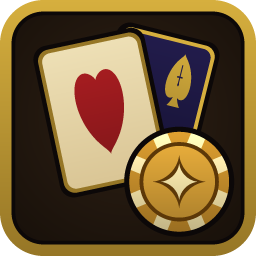
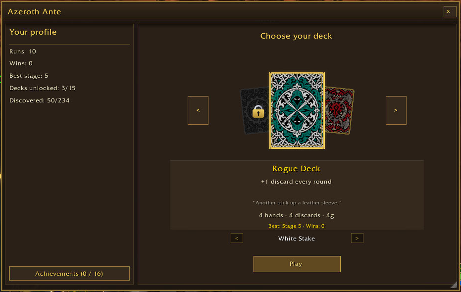
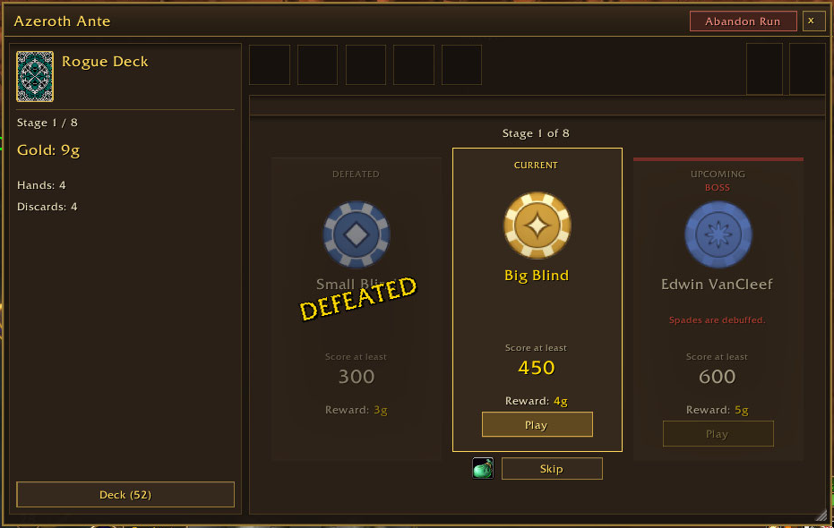
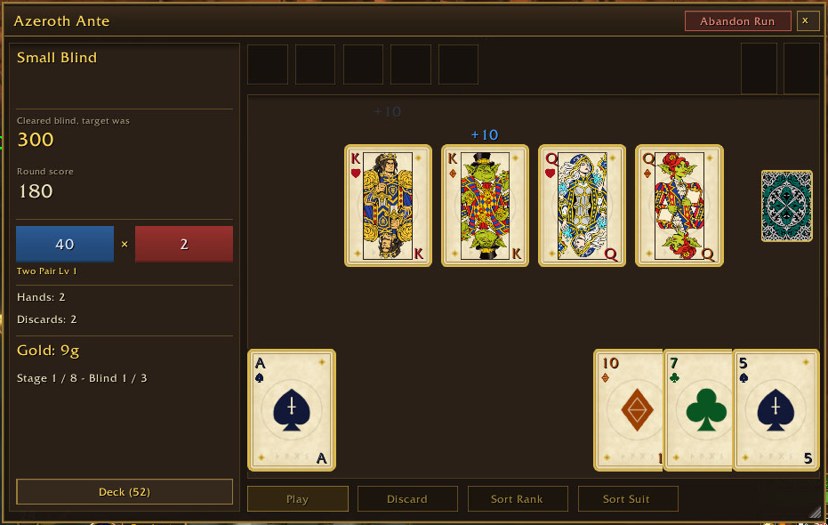
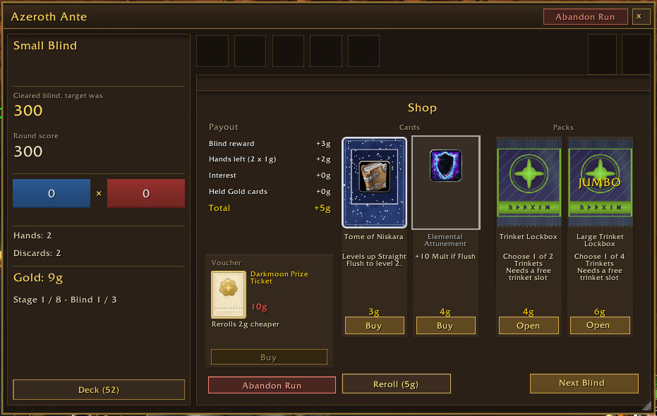

<p align="center">
  
</p>

<h1 align="center">Azeroth Ante</h1>

[](https://github.com/lgulliver/azeroth-ante/actions/workflows/lint.yml) [](https://github.com/lgulliver/azeroth-ante/actions/workflows/test.yml)

## What it is

A Balatro-style poker roguelike with a World of Warcraft skin, for Retail and
WoW Forever on the modern Mainline API. Play while waiting in queues: joining
opens the window, a queue pop shows an overlay and plays a sound, and accepting
or entering combat hides it. Taking a flight path opens it too, and landing
closes it again; turn this off under Options > AddOns > Azeroth Ante. Use
`/ante` to toggle the window at any time.
Mouse controls only; no key bindings.

## Screenshots

Choosing a deck: fifteen decks, each with its own painted back and rule, and the stake to
play it at.



Choosing a blind: each stage is a Small Blind, a Big Blind and a boss with its own rule.
Skip the small or big blind for the tag shown beside Skip.



Playing a hand: Jacks, Queens and Kings are double-ended court cards of Warcraft
characters, and the sidebar shows the hand's chips × mult as it scores.



The shop after a cleared blind: payout, cards, packs and a voucher.



## Install

Copy or symlink the `AzerothAnte/` folder into your client's add-on directory:

- Retail: `World of Warcraft/_retail_/Interface/AddOns/`
- Forever: `World of Warcraft/_forever_/Interface/AddOns/`

The resulting path must end in `Interface/AddOns/AzerothAnte/AzerothAnte.toc`.
Enable Azeroth Ante in the character selection screen's AddOns menu.

## Set the Interface version

In each client, run:

```text
/dump select(4, GetBuildInfo())
```

Set `## Interface` in `AzerothAnte/AzerothAnte.toc` to the returned number.
The shipped line is `## Interface: 120100, 120105, 120107, 16001`. If your client returns a
number that isn't listed, add it to that comma-separated list (or replace the
list with your number).

If `## Interface` doesn't match your client, enable "Load out of date AddOns"
on the character-select AddOns screen until you set the right number.

## How to play

1. Choose a deck, then start a blind and reach its target score.
2. Select one to five cards to play a poker hand; stronger hands score more.
3. Score chips × multiplier, and discard unwanted cards within your limits.
4. Spend gold in the shop on trinkets, consumables and packs to improve future hands.
5. Beat three blinds per stage across eight stages. You lose when you run out of
   hands, or when your hand and deck are both empty with the blind still unbeaten.

**Trinkets** come in 150 kinds: every Balatro joker. The five legendaries (Frostmourne, Shalamayne, Shadowmourne, Ashbringer and Dragonwrath) never appear in the shop or packs; only the Heart of Azeroth creates one.
They score left to right, so order matters: drag a trinket left or right in the trinket row to reorder it. Engineering Schematic copies the
trinket to its right and Mind Control copies the leftmost one; rule trinkets can't be copied.
Hover a trinket for its live values and sell price. You can sell trinkets during a blind as well as
in the shop; a bigger hand size draws cards at once, a smaller one applies from the next deal, and
the counts of hands and discards change at once.

Trinkets can also change and create cards (Gilded Mask, Vampiric Embrace, Pilgrim's Bounty, Gnomish Cloning Device, Letter of Commendation and Stoneform),
create consumables, and disable a boss's effect (Gladiator's Medallion).

**Consumables** sit in slots beside your trinkets. Click one to Use or Sell it.

- Scrolls change cards. Select the cards first; the popover shows what will be affected.
- Tomes level up a poker hand. Hand levels stay visible: the sidebar shows e.g.
  "Pair Lv 3" for your selection, and a Tome's tooltip shows "Pair: Lv 2 -> 3".
- Relics are powerful one-offs with a cost, such as adding cards or creating a trinket.

**Card types** come from Scrolls and packs, and show on the card and in its tooltip.

- Enhancements change how a card scores (Bonus, Mult, Wild, Glass, Steel, Stone, Gold, Lucky).
- Editions add a shimmer and a bonus: Foil, Holographic, Polychrome or Negative.
- Seals (Gold, Red, Blue, Purple) trigger when a card is played, held or discarded.

**Packs** are bought in the shop. Opening one shows a choice; pick from it, or Skip.
Scribe's Satchels and Relic Caches also show a hand to aim Scrolls at. A pack left open survives `/reload`.

**Deck view**: the Deck button in the sidebar lists every card you own, with its
types, grouped by suit. Hover a card for details.

**Vouchers**: each stage's shop offers one voucher in its own tile. Buying one is a
permanent upgrade for the rest of the run (extra hands, discards or hand size, cheaper
or bigger shops, higher interest caps, and more). Most vouchers are upgrades; the two
hourglasses trade off (a stage back, and a hand or discard fewer each round). Each of the 16 base vouchers has a
stronger tier-two upgrade that can only appear once you own the base voucher and have
earned its achievement. The voucher changes after each stage's boss. Discounts never
apply to rerolls or the boss reroll.

**Boss reroll**: the Bounty Board voucher lets you reroll the upcoming boss once per
stage for 10g; its upgrade, Infinite Bounty, removes the limit. It is only offered on the
blind screen; at the final stage it rerolls into another finisher.

**Decks**: fifteen, one for each of Balatro's starting decks, each with its own rule and
painted back: Rogue, Warrior, Goblin, Monk, Warlock, Mage, Draenei, Death Knight, Forsaken,
Alliance, Trade Prince, Hunter, Evoker, Balance Druid and Gnome. Rogue is open from the start;
the others unlock in turn as you discover items (trinkets, Scrolls, Tomes, Relics and vouchers).

**Stakes** raise the difficulty, as in Balatro. Pick one under the deck on the deck screen;
each adds to every stake below it: Red (no small blind reward), Green (faster-scaling
targets), Black (Eternal trinkets, which can't be sold or destroyed), Blue (one discard fewer),
Purple (targets scale faster still), Orange (Perishable trinkets, debuffed after 5 rounds) and
Gold (Rental trinkets: 1g to buy, 3g each round). Every deck starts on White Stake; winning
with a deck unlocks its next stake. Trinket stickers show as small badges on the icon
(E, P with rounds left, R) and in the tooltip.

**Achievements** are addon-internal. They are tracked and stored in the addon's own
SavedVariables (`AzerothAnteDB`) and are never WoW achievements: they do not touch
your character's Blizzard achievements. Each unlocks a tier-two voucher, shows a toast
when earned, and is listed with its progress in the Achievements view. Progress is
kept across runs, and saves from before vouchers existed are upgraded, not discarded.

## Running the tests

From the repository root, with LuaJIT and Python 3 installed:

```sh
luajit tests/run.lua
luajit tests/smoke_ui.lua   # headless UI run against a WoW API stub (catches Lua errors only)
luajit tests/syntax.lua
python3 tests/test_media.py
```

A few tests also use local developer tools that are not part of the repository; without them those
tests are skipped.

## In-game test checklist

Run these checks in Retail and Forever:

- [ ] `/ante` opens it.
- [ ] Drag and resize work.
- [ ] Card hover and select feel smooth.
- [ ] Jacks, Queens and Kings show their double-ended court art in a thin frame on the card's parchment, clear of the corner rank and suit, and an 8-card hand overlaps neatly at the larger card size.
- [ ] The tally plays.
- [ ] A face-down card shows its back and flips when played.
- [ ] Buying in the shop works.
- [ ] The small and big blinds show a tag and a Skip button; skipping gives the tag and goes to the next blind with no shop.
- [ ] The sidebar's tag row doesn't overlap the round info with several vouchers owned.
- [ ] A tag that gives a free pack opens it on the blind screen, and the blind cannot start until it is picked from or skipped.
- [ ] `/reload` mid-round resumes on the same hand.
- [ ] Joining a queue opens the window.
- [ ] A queue pop shows the overlay and plays the sound.
- [ ] Accepting hides the window.
- [ ] Entering combat hides the window.
- [ ] No trinket icon is blank or a question mark (check Avenging Wrath, Multi-Shot, Whetstone and Hunter's Mark especially, and the legendaries: Frostmourne, Shalamayne, Shadowmourne, Ashbringer, Dragonwrath).
- [ ] With Dragonwrath and a consumable held, Next Blind adds a Negative copy with the Negative tint in an extra slot.
- [ ] The deck carousel shows all fifteen backs, each distinct, and the new decks' rule text fits the tile.
- [ ] A Balance Druid hand shows "Balanced!" in the tally and the chips and mult boxes even out.
- [ ] The deck screen's stake row (< White Stake >) fits between the deck tile and Play, and its tooltip lists the stake's rules.
- [ ] On Black Stake and up, sticker badges (E, P5, R) sit on trinket icons without hiding them, and an Eternal trinket's sell button reads "-".
- [ ] `/reload` in the shop resumes on the shop screen.
- [ ] `/reload` on the blind screen resumes on the blind screen.
- [ ] A queue pop during combat plays the sound only; the window opens after combat.
- [ ] A PvP queue (battleground) opens the window, and the pop shows the overlay.
- [ ] Taking a flight path opens the window; landing closes it.
- [ ] With "Open on flight paths" unticked in Options > AddOns > Azeroth Ante, a flight leaves the window shut.
- [ ] One full run to the win or lose screen.
- [ ] Edition shimmer (Foil, Holographic, Polychrome, Negative) is visible and smooth.
- [ ] A Glass card shatters when it breaks.
- [ ] Use works on cards in play and on cards in a pack.
- [ ] `/reload` with a pack open resumes on the same pack and choices.
- [ ] A hand of more than 8 cards still fits the play area.
- [ ] The deck view opens, shows every card and its types, and closes.
- [ ] Buying the shop's voucher works: the tile stamps BOUGHT, then reads "Sold out this stage", and its effect applies.
- [ ] The boss reroll works (with the Bounty Board voucher) and is limited as described.
- [ ] Earning an achievement shows a toast.
- [ ] The Achievements view opens, lists every achievement with progress, and closes.
- [ ] `/reload` mid-run after updating the addon keeps the run (the old save migrates).
- [ ] Abandon Run asks for a second click (and reverts after 3 seconds), then returns to the deck screen.

## Art

The textures are original to this project; card backs and court cards are painted. Blizzard icons are
referenced from the game rather than bundled.

## Licence

[MIT](LICENSE). See [CONTRIBUTING.md](CONTRIBUTING.md) to help out and [CHANGELOG.md](CHANGELOG.md) for what changed.
